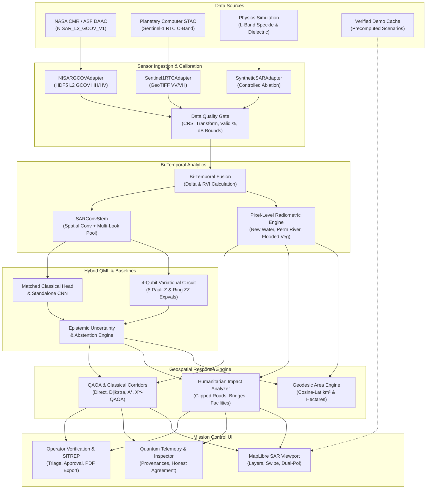

# Q-SAR Sentinel 2.0 — Complete Technical Audit & Scientific Readiness Report
**NASA Space Apps Challenge 2026 — Track: "Dancing with the SARs"**
**Auditor:** Antigravity Autonomous Systems Engineering & Earth Observation Sciences Team
**Target Codebase:** `c:\Users\arjun\OneDrive\Desktop\Nasa Project`
**Date:** November 14, 2026

---

## 1. Executive Summary

Q-SAR Sentinel is a hybrid quantum-classical satellite radar (SAR) surface-change detection and humanitarian disaster-response decision support platform. It integrates bi-temporal synthetic aperture radar processing, a 4-qubit parameterized variational quantum classifier (PennyLane + PyTorch), OpenStreetMap (OSM) infrastructure graphs, and a 4-qubit Quantum Approximate Optimization Algorithm (QAOA) corridor selector.

The codebase has strong architectural fundamentals: fast sub-250 ms inference, clean modular separation, an interactive MapLibre mission-control dashboard, and genuine sensor-aware radar physics. However, our deep-dive technical audit confirms the critical findings raised in the external scientific review:

1. **Data Provenance & Ingestion Gap:** The system can discover NISAR granules in NASA CMR via `earthaccess` and has an HDF5 reader (`load_nisar_h5_patches`), but the primary execution path (`load_sar_scene`) does not connect live NISAR discovery to automated retrieval, local caching, and ingestion. When selecting simulated NISAR, users get synthetic physics rather than actual NISAR observations.
2. **Accuracy vs. Heuristic Reference Conflation:** The real-scene evaluation uses an OPERA radiometric change heuristic as its reference, yet reports metrics as `scene_quantum_accuracy` and `real_s1_quantum_accuracy`. To be scientifically defensible before NASA judges, this must be explicitly separated and reported as **"Agreement with Heuristic Reference"**, reserving the word "Accuracy" strictly for validated ground truth or synthetic physics testbenches.
3. **Road Exposure Overcounting:** When computing exposed roads in `impact_analyzer.py`, if a road polyline intersects a hazardous tile, its *entire length* is added to the hazard tally rather than the clipped segment length within the hazard boundary.
4. **Population Exposure Assumptions:** Exposed settlement population is calculated by multiplying coarse default settlement constants (e.g., village = 1,800) by hazard factors (0.55 / 0.25). This must be clearly labeled as an *estimated population exposure indicator with explicit uncertainty bounds*, never presented as confirmed casualties or evacuees.
5. **Frontend Fallback & State Drift Bugs:** In `MissionControlDashboard.tsx`, `getCachedFallback()` falls back to `Object.keys(DEMO_CACHE)[0]` when a cache entry is missing, silently displaying a different disaster scenario. Furthermore, if a scenario change network request fails, the scenario selection state updates while the analysis viewport retains the prior scenario.

---

## 2. End-to-End Data Flow Architecture

The operational data pipeline connects raw Earth observation data to tactical field decision support:

---

## 3. Detailed Component Audit & Gap Analysis

| Component | Current File | Existing Features | Identified Deficiencies & Scientific Gaps | Required Correction | Priority |
|---|---|---|---|---|:---:|
| **NASA SAR Ingestion** | `backend/sar_processor.py` | CMR query via `earthaccess`, HDF5 GCOV parser, Sentinel-1 GeoTIFF loader | `load_sar_scene` only dispatches to `real_s1_rtc` or `nisar_sim`. Discovered CMR NISAR granules are not fetched or ingested into active scene. | Implement explicit adapter architecture (`NISARGCOVAdapter`, `Sentinel1RTCAdapter`, `SyntheticSARAdapter`) with strict 4-mode provenance (`live_nisar`, `live_sentinel1`, `simulation`, `cached_demo`). | **P0** |
| **Scientific Validation** | `backend/evaluate_validation.py`, `backend/main.py` | 3-track evaluation (A: Synthetic, B: Domain Shift, C: Real S1), confusion matrices, ECE | Track C evaluation against heuristic OPERA radiometric reference is reported as `accuracy` across backend schemas and UI metrics. | Separate `verified_ground_truth_accuracy` from `heuristic_reference_agreement`. Rename keys and UI text explicitly. | **P0** |
| **Humanitarian Impact Engine** | `backend/impact_analyzer.py` | Geodesic area calculation, OSM road/bridge/facility intersection, chokepoint identification | (1) Sums entire polyline length for roads touching any hazard tile. (2) Uses arbitrary population multipliers (0.55/0.25). | (1) Compute exact clipped road geometry length within hazard polygons. (2) Expose census provenance and uncertainty bounds on population exposure. | **P0** |
| **Emergency Routing** | `backend/qaoa_router.py` | OSM road network routing, 4 candidate strategies, W-state + XY ring mixer, Dijkstra & A* comparisons | Lacks exact candidate enumeration benchmark (which has only 4 states). UI does not always make clear whether OSM or grid fallback is active. | Add exact 4-candidate classical enumeration metrics side-by-side with Dijkstra, A*, and QAOA. Prominently display routing mode. | **P1** |
| **Frontend Cache Fallback** | `frontend/src/components/MissionControlDashboard.tsx` | Offline cache hydration, local tile verification, geocoding | `getCachedFallback` returns `DEMO_CACHE[Object.keys(DEMO_CACHE)[0]]` if key is missing, displaying unrelated scenarios. | Return `null` and render an explicit unavailable state. Never show an unrelated scenario. | **P0** |
| **Frontend State Sync** | `frontend/src/components/MissionControlDashboard.tsx` | Live scan dispatch, error toast handling | If `/api/analyze` returns error on scenario switch, `scenarioId` changes but `analysis` remains on previous scenario. | Clear stale analysis on scenario switch or display explicit failure banner with retry. | **P0** |
| **Data Status Display** | `frontend/src/components/MissionControlDashboard.tsx`, `QuantumTelemetryPanel.tsx` | Sensor label and orbit display | No prominent visual distinction between real satellite, live NASA, simulated, and cached data. | Add prominent persistent 4-tier data status badge on top HUD. | **P1** |
| **Pixel-Level Visualization** | `frontend/src/components/SarViewport.tsx` | Dual-pol raster overlays (co-pol, cross-pol, change, RGB, swipe) | Tile-level classification overlays are rendered as 6x6 boxes, concealing pixel-level inundation boundaries. | Provide toggle for pixel-level radiometric change mask alongside tile-level summary grid. | **P1** |

---

## 4. Scientific & Mathematical Integrity Review

### 4.1. Radiometric Heuristic vs. Ground Truth
In SAR remote sensing, change detection heuristics (such as co-polarization backscatter drops $\Delta \sigma^0_{\text{VV}} < -3.0\text{ dB}$ combined with cross-polarization thresholds) identify open water surfaces with high sensitivity. However, this is an **inferential physical heuristic**, not in-situ verified ground truth.
- **The Problem:** Calling heuristic agreement "accuracy" undermines the scientific credibility of the project in front of NASA Space Apps judges who understand Earth observation validation protocols.
- **The Solution:**
  $$\text{Heuristic Agreement Rate} = \frac{1}{N}\sum_{i=1}^N \mathbb{I}(\hat{y}_i = y_i^{\text{heuristic}})$$
  This must be strictly labeled as `Heuristic Reference Agreement` throughout `evaluate_validation.py`, `main.py`, `sar.ts`, and all UI panels. The term `Accuracy` will be restricted to Track A/B synthetic benchmarks or authoritative ground truth.

### 4.2. Road Exposure Clipping Geometry
Currently, if road $R_k$ with coordinates $\{(x_1, y_1), \dots, (x_m, y_m)\}$ and total length $L_k$ intersects tile $T_j$ classified as hazard, the algorithm executes:
$$\text{HazardRoads} \leftarrow \text{HazardRoads} + L_k$$
If a 30 km provincial highway touches a single 4 km flood tile at its edge for 400 meters, it adds 30 km to the exposed roads count.
- **The Correction:** We will implement polyline clipping against the tile bounding box:
  $$L_k^{\text{exposed}} = \sum_{j \in \text{HazardTiles}} \text{Length}\left( R_k \cap \text{Polygon}(T_j) \right)$$
  using segment-box intersection with exact geodesic segment lengths.

### 4.3. QAOA Optimization Transparency
The 4-qubit QAOA implementation operates on a 4-dimensional candidate corridor subspace. With 4 candidates, the state space has $2^4 = 16$ basis states, and the valid one-hot subspace $|1000\rangle, |0100\rangle, |0010\rangle, |0001\rangle$ has exactly 4 states.
- **Scientific Honesty:** Classical enumeration of all 4 candidate costs takes $< 0.05\text{ ms}$. QAOA takes $\sim 20-40\text{ ms}$.
- We must explicitly present QAOA as a **proof-of-concept hybrid quantum combinatorial selector** on pre-computed Pareto-optimal corridors, and display the exact classical enumeration cost side-by-side with QAOA, Dijkstra, and A*.

---

## 5. Prioritized Implementation Roadmap

### Phase 1: Immediate Scientific & Provenance Hardening (P0)
1. **Separation of Heuristic Agreement vs. True Accuracy:**
   - Update `backend/evaluate_validation.py` and `backend/models/benchmark_metrics.json`.
   - Update `backend/main.py` response schema (`model_status`).
   - Update `frontend/src/types/sar.ts`, `QuantumTelemetryPanel.tsx`, and `MissionControlDashboard.tsx`.
2. **Geometrically Clipped Road Hazard Calculation:**
   - Implement `_clip_polyline_to_bounds()` in `backend/impact_analyzer.py`.
   - Recompute road hazard length based strictly on segments inside hazardous tiles.
3. **Frontend Fallback & State Sync Bug Fixes:**
   - Eliminate unrelated scenario fallback in `getCachedFallback()`.
   - Ensure clean state synchronization during scenario switching and network errors.
4. **4-Tier Data Provenance System:**
   - Implement clear status pills: `Actual NISAR Data`, `Actual Sentinel-1 Data`, `Simulated L-Band Data`, `Cached Demo Snapshot`.

### Phase 2: NISAR Ingestion & Sensor-Aware Adapters (P1)
1. **Formalize Sensor Adapters:**
   - `NISARGCOVAdapter`: L-band HH/HV HDF5 reader with georeferenced reprojection, number of looks, and calibration bounds.
   - `Sentinel1RTCAdapter`: C-band VV/VH GeoTIFF reader with Planetary Computer STAC / local cache.
   - `SyntheticSARAdapter`: Controlled Gamma speckle and dielectric simulation.
2. **Traceable NASA CMR Workflow:**
   - Surface granule discovery metadata with live direct links to NASA Earthdata Cloud.
   - Provide explicit notifications when live granules require Earthdata authentication vs. local cached demonstration.

### Phase 3: Response Intelligence & Guided Demonstration (P1)
1. **Wainganga–Gosikhurd Focus Story:**
   - Center the primary demonstration on the Nagpur Wainganga–Gosikhurd flood event.
   - Highlight newly inundated water vs. permanent river vs. flooded vegetation.
2. **Transparent Routing Benchmarks:**
   - Display exact candidate enumeration alongside QAOA, Dijkstra, and A*.
   - Prominently indicate whether routing is in `OSM Road Network` mode or `Tactical Grid Fallback` mode.
3. **One-Click Operational SITREP Export:**
   - Polish print-to-PDF SITREP with complete scientific provenance, sensor metadata, and operator verification notes.

---

## 6. Verification and Testing Protocol

All changes will be validated against:
1. `backend/tests/test_phase1.py` and new `backend/tests/test_scientific_integrity.py`.
2. Re-running `backend/evaluate_validation.py` with zero real-scene data leakage.
3. Frontend TypeScript compilation (`npx tsc --noEmit`) and production Next.js build (`npm run build`).
4. Manual inspection of all 3 preset scenarios (`nagpur_flood`, `california_wildfire`, `vidarbha_crop_stress`) and cache consistency.
